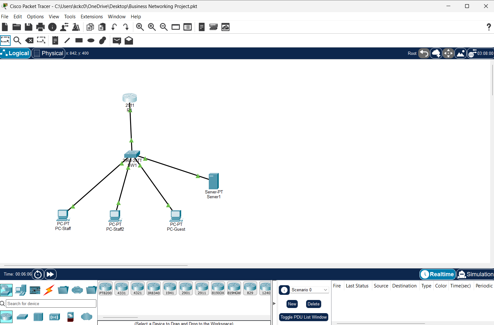

# Secure Small-Business Network Lab

A virtual lab where I designed, secured, and monitored a small-business network in Cisco Packet Tracer. I then tested it with simulated attacks and fixed the weaknesses I found.

## What this project shows
- Segmenting a network into VLANs (Staff, Servers, Guest, Management)
- Inter-VLAN routing with router-on-a-stick
- Restricting traffic between networks with an extended ACL
- Central logging with syslog
- Hardening a switch by disabling and parking unused ports
- Testing, troubleshooting, and documenting my work

## Network design

| VLAN | Name | Subnet | Gateway |
|---|---|---|---|
| 10 | Staff | 192.168.10.0/24 | 192.168.10.1 |
| 20 | Servers | 192.168.20.0/24 | 192.168.20.1 |
| 30 | Guest | 192.168.30.0/24 | 192.168.30.1 |
| 99 | Management | 192.168.99.0/24 | 192.168.99.1 |

**Devices:** 1 router (2911), 1 switch (2960), 2 staff PCs, 1 server, 1 guest PC, and a rogue PC used for attack testing.

## Key results

| Test | Result |
|---|---|
| Guest device to company server | Blocked by ACL |
| Guest device to management network | Blocked by ACL |
| Rogue device on an unused port | Reached the server before hardening, blocked after |
| Staff PC to server | Allowed throughout |
| Router and switch events | Visible on the syslog server |

## Documentation
1. [Network design](docs/01-network-design.md)
2. [Implementation and security](docs/02-implementation.md)
3. [Monitoring with syslog](docs/03-monitoring.md)
4. [Attack tests and hardening](docs/04-attack-tests.md)

## How to open the lab
1. Install [Cisco Packet Tracer](https://www.netacad.com) (free with a Networking Academy account).
2. Download `business-network-lab.pkt` from the `diagrams` folder.
3. Open it in Packet Tracer. Device configs are also saved as text in the `configs` folder.

## Skills demonstrated
Cisco IOS command line, VLANs, 802.1Q trunking, inter-VLAN routing, access control lists, syslog, switch port hardening, network troubleshooting, and technical documentation.

## Limitations and next steps
- Staff devices can still reach the management VLAN. An ACL on the staff subinterface would restrict this.
- Add port security on the ports in use.
- Add password-protected logins and SSH for device management.
- Add a dedicated firewall at the network edge.
- Packet Tracer does not support ACL logging, so blocked traffic is proven through ACL match counters instead of syslog.

## Project structure
- `docs/` - write-ups for each phase
- `configs/` - saved router and switch configurations
- `diagrams/` - the Packet Tracer lab file
- `screenshots/` - evidence from each test

## Progress
- [x] Project structure created
- [x] Choose lab tools (Cisco Packet Tracer)
- [x] Design the network
- [x] Build VLANs, trunk, and inter-VLAN routing
- [x] Add ACL security rules
- [x] Set up monitoring (syslog)
- [x] Run test attacks and record results
