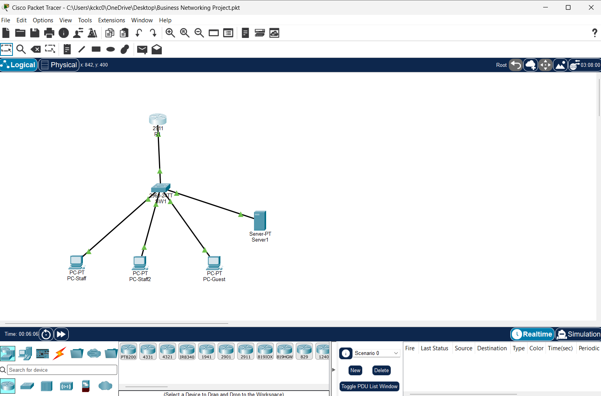
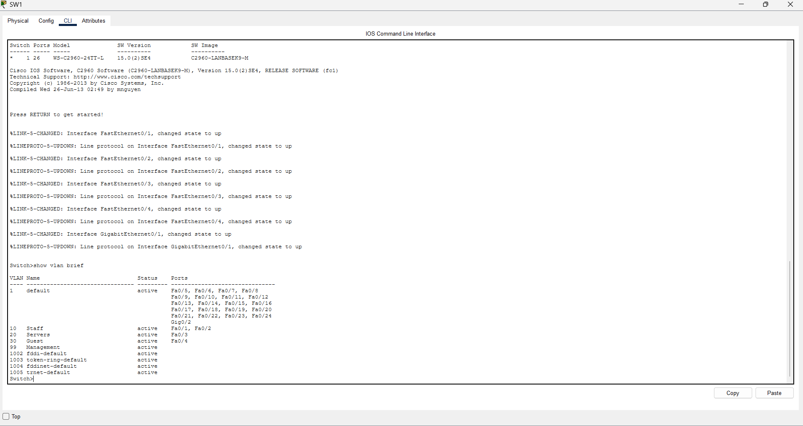
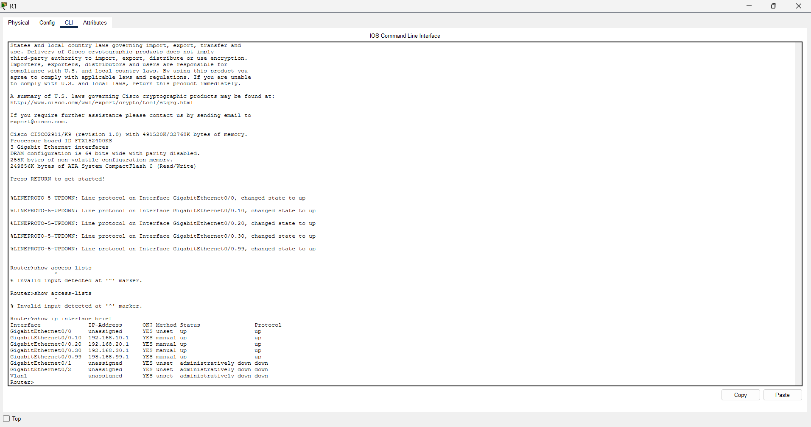
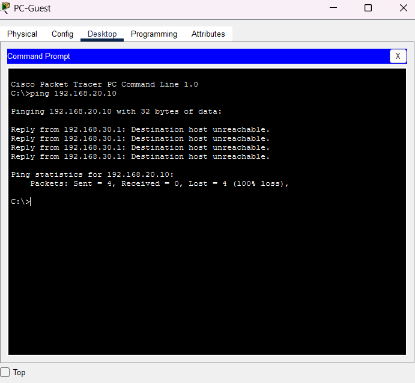
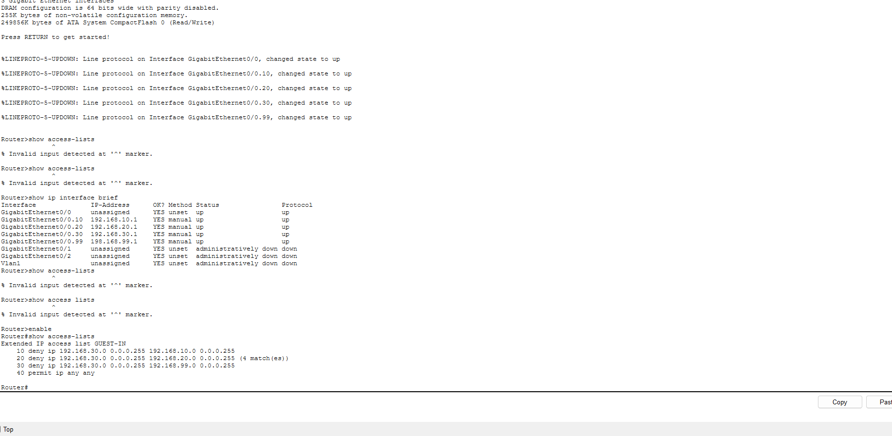

# Phase 2: Implementation and Security

## What I built
A small-business network using router-on-a-stick: one switch, one router, and four VLANs separated by a trunk link.

## VLANs
I created VLANs 10 (Staff), 20 (Servers), 30 (Guest), and 99 (Management), and assigned each switch port to its VLAN.

## Trunk and router
The switch connects to the router through a trunk on Gi0/1. The router has one subinterface per VLAN, each acting as that VLAN's gateway.

## Security: isolating the guest network
An extended ACL named GUEST-IN is applied inbound on the guest subinterface. It blocks guest traffic to the Staff, Servers, and Management VLANs and allows everything else.

## Test results

| Test | Result |
|---|---|
| Staff PC to Staff PC | Replies |
| Staff PC to server | Replies |
| Guest to server | Blocked |
| Guest to staff PC | Blocked |
| Guest to its own gateway | Replies |

## What I learned
VLANs separate traffic but they don't secure it on their own. After creating the VLANs, my guest PC could still reach the company server because the router connects every VLAN by default.
- **One trunk link can carry many VLANs.** Using router-on-a-stick, I gave each VLAN its own subinterface on a single router port so one cable acts as the gateway for four networks.
- **ACLs are what enforce the rules.** Placing a named extended ACL on the guest subinterface blocked guests from the Staff, Servers, and Management networks, and the match counters on `show access-lists` proved it was working.
- **ACL order matters.** The router reads rules top to bottom and drops anything that doesn't match, so the final `permit ip any any` line is needed to keep normal guest traffic working.
- **Testing is part of the job.** I checked both what should work and what should be blocked, and I learned to use `show` commands to verify my configuration instead of assuming it was right.
- **Router modes matter.** Commands like `show access-lists` only work in privileged mode (`Router#`), so I needed `enable` first
