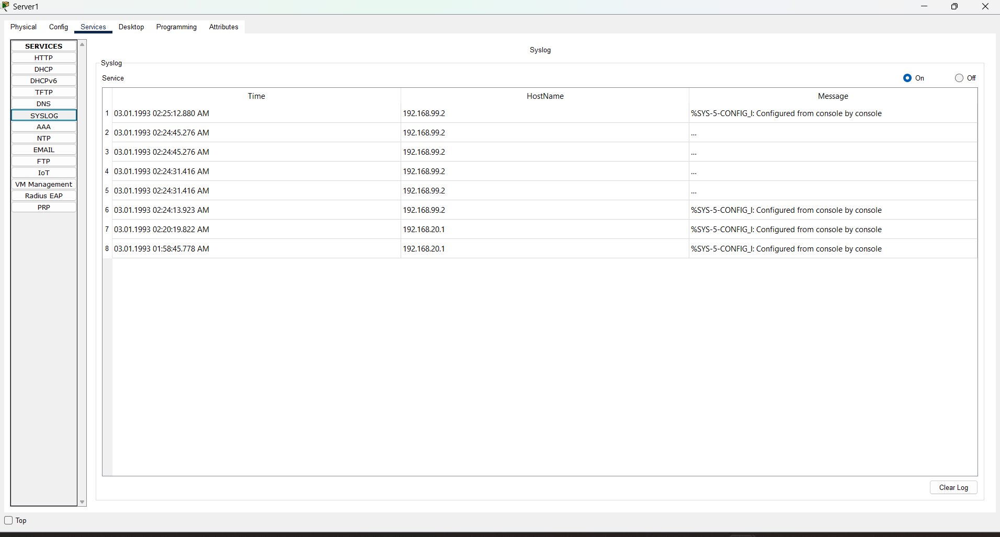
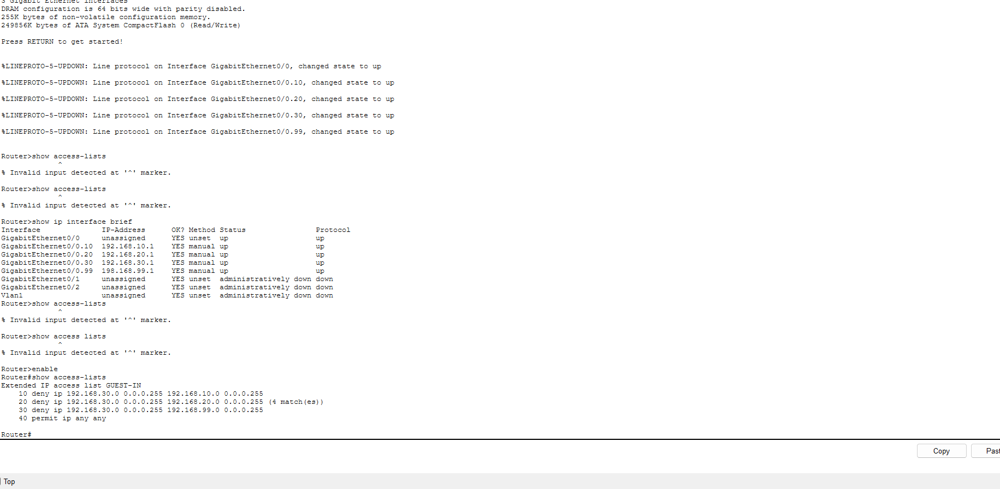

# Phase 3: Monitoring with Syslog

## Goal
Collect logs from the router and switch in one place so changes and events can be reviewed centrally.

## How it works
Server1 (192.168.20.10) runs the Syslog service. R1 and SW1 are configured with `logging host 192.168.20.10` and send their event messages to it. Timestamps are enabled so each message shows when it happened.

The switch needed its own management address on VLAN 99 (192.168.99.2) and a default gateway (192.168.99.1) so it could reach the server on a different network.

## What I tested
- Entered configuration mode on the router and switch. Each produced a "configured from console" message on the server.
- Shut down and re-enabled the guest port (Fa0/4) on the switch. The server received the link state change messages.

## Blocked traffic evidence
Packet Tracer's ACLs do not support the `log` keyword, so blocked packets are not sent to syslog. Instead, I used the ACL match counters as proof that the guest rules are working.

## Limitations
- Packet Tracer does not support `logging trap`, so the default logging level was used.
- ACL hits are visible only through match counters, not through syslog.
- Device clocks default to 1993 unless set manually.

## What I learned
- **Central logging gives one place to look.** With syslog, the router and switch both reported to Server1, so I could see events from different devices in a single table instead of logging into each one.
- **A switch needs its own management address to send logs.** The switch had no IP address at first, so it could not reach the server. Adding a VLAN 99 interface (192.168.99.2) and a default gateway fixed this, because the server is on a different network.
- **Troubleshoot from the nearest device outward.** When the switch could not ping the server, I tested the router first (192.168.99.1), then the server. Fixing the closest failure first showed the real problem.
- **A VLAN interface only comes up if the VLAN is active.** The management interface depended on VLAN 99 existing and being allowed on the trunk to the router.
- **Not every command works on every device.** Packet Tracer rejected `logging trap` and the `log` keyword on ACL rules. I read the `^` error marker to find the unsupported word, then used ACL match counters as evidence instead.
- **Small details break configs.** ACL names are case-sensitive, so `Guest-IN` and `GUEST-IN` were two different lists, and my first version of the ACL silently allowed everything. Checking with `show access-lists` caught it.
  
