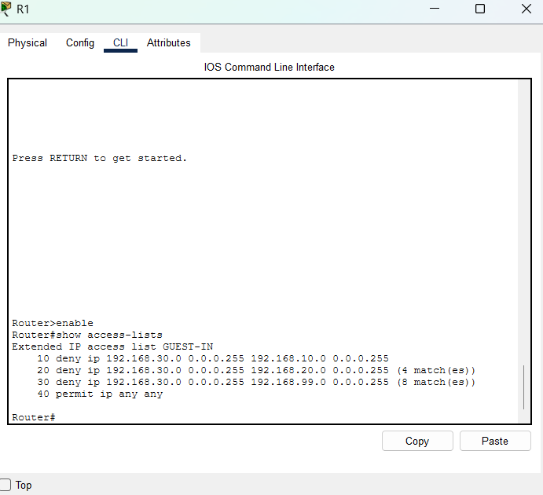
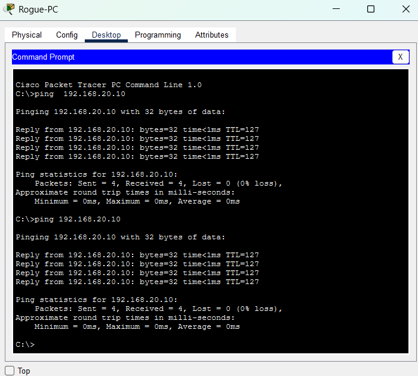
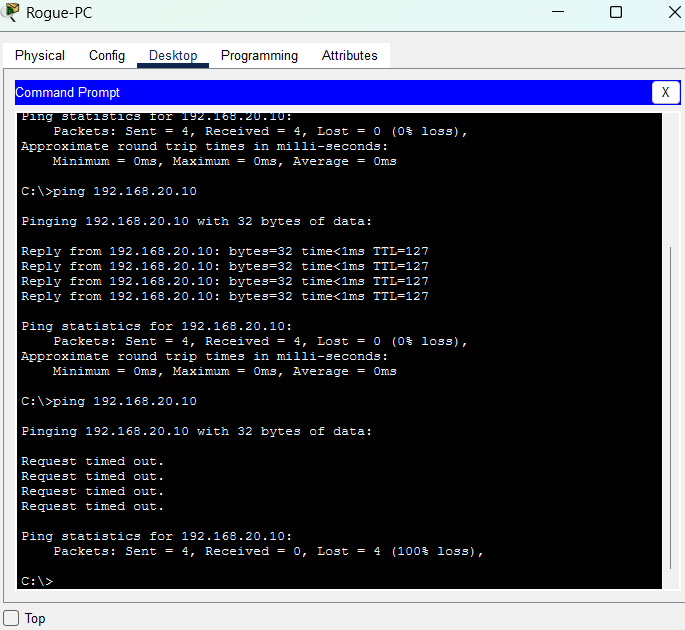

# Phase 4: Attack Tests and Hardening

## Goal
Test the network the way an attacker or careless visitor might, record the results, fix any weakness, and test again.

## Attack 1: Guest tries to reach the management network
**Scenario:** A guest device tries to contact the switch and router management addresses (192.168.99.1 and 192.168.99.2).

**Result:** Blocked. The GUEST-IN ACL denies traffic from the guest VLAN to the management VLAN, and the match counter on that rule increased.

## Attack 2: Rogue device on an unused switch port
**Scenario:** Someone plugs an unknown laptop into an unused, enabled switch port.

**Before the fix:** The rogue device was placed in the Staff VLAN and could reach the company server at 192.168.20.10.

**Fix:** I created a VLAN 999 ("Unused"), moved every unused switch port into it, and shut those ports down.

**After the fix:** The port went down and the rogue device could no longer reach anything.

## Test results

| Test | Before | After |
|---|---|---|
| Guest to management network | Blocked | Blocked |
| Guest to server | Blocked | Blocked |
| Rogue device on unused port to server | Allowed | Blocked |
| Staff PC to server | Allowed | Allowed |

The port shutdowns also appeared as link-down messages in the syslog table, so the change was visible in monitoring.

## Remaining gaps and future improvements
- Staff devices can still reach the management VLAN. An ACL on the staff subinterface would restrict this.
- Port security (limiting which devices can use a port) would protect the ports that are in use.
- A dedicated firewall at the network edge would add another layer of defense.
- Router and switch logins are not yet protected with passwords or SSH.

## What I learned
- **Testing finds problems that configuration doesn't.** The network looked secure until I played the attacker and then an unused port exposed the company server.
- **Unused ports are a real risk.** An enabled port with no device is an open door, so unused ports should be disabled and parked in a dead-end VLAN.
- **Verify the fix with the same test.** Running the same ping before and after the change gave clear evidence that the hardening worked.
- **Hardening can break things.** After changing the switch I rechecked that staff could still reach the server, so security changes didn't cut off legitimate users.
- **Layers matter.** The ACL protects traffic between VLANs, while port lockdown protects the physical access points. Each one covers a gap the other can't.
- **Know your limits.** Documenting what is still unprotected is part of a security write-up, not a weakness in it.
